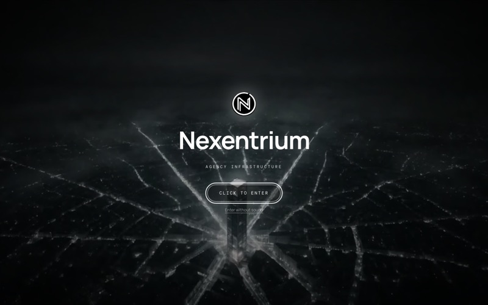
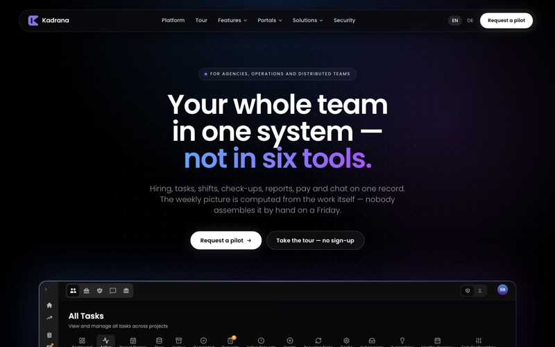
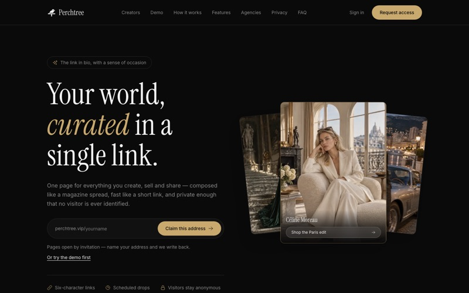
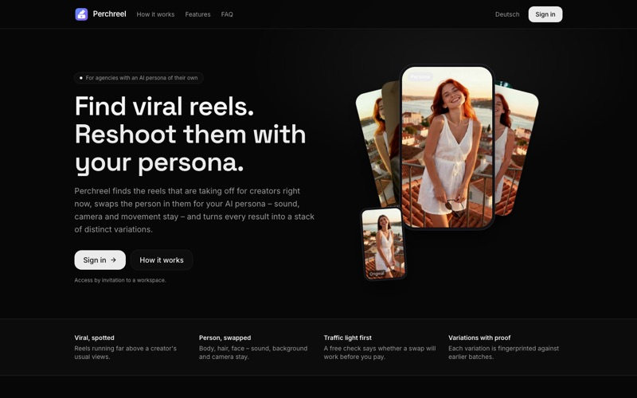
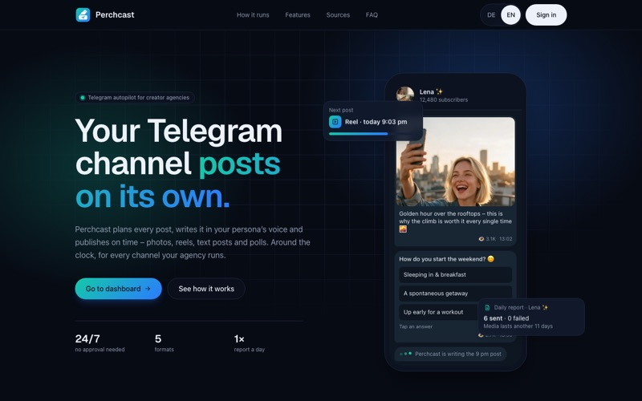
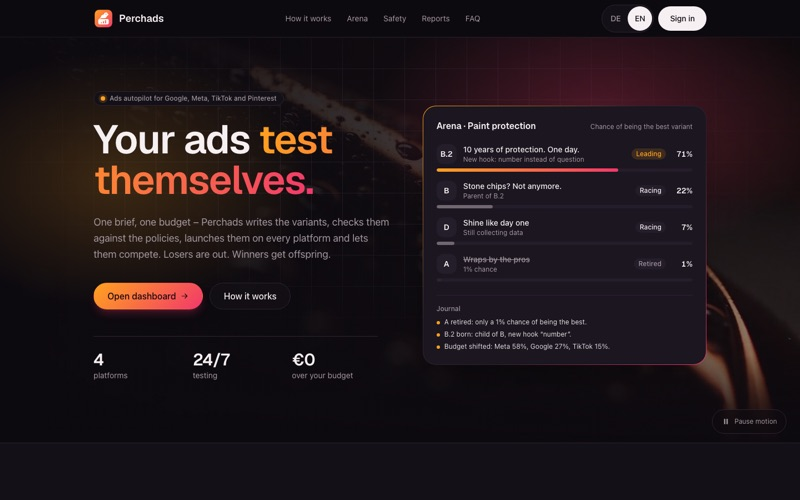
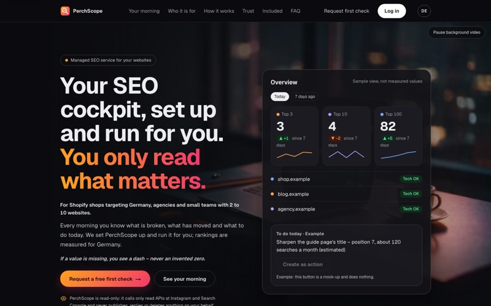
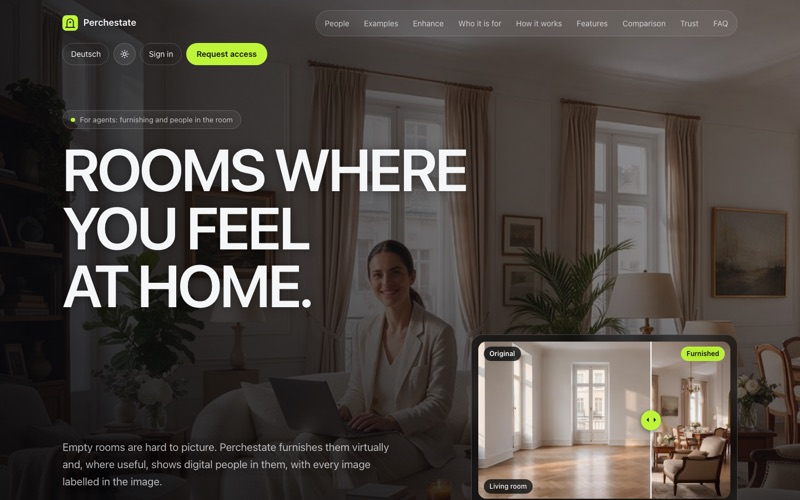

<p align="center">
  
</p>

<p align="center">
  <a href="https://modelsuite.ai/en"></a>
</p>

<p align="center">
  <a href="https://nexentriumtech.com/en"></a>
  <a href="https://modelsuite.ai/en"></a>
  <a href="https://www.linkedin.com/in/patrickschmetzer"></a>
  
</p>

---

### ⚡ About

I build products end to end: backend systems, APIs, automation and the tools around them.
**[Nexentrium](https://nexentriumtech.com)** is my company for software platforms, automation and digital products – home of ModelSuite, Kadrana and the Perch family of tools.

```ts
const patrick = {
  company: "Nexentrium",
  role: "Founder & CEO @ ModelSuite.ai",
  builds: ["SaaS platforms", "APIs", "automation", "dev tools"],
  focus: "simple systems that solve complex problems",
  location: "Germany 🇩🇪",
};
```

### 🌐 The Nexentrium ecosystem

<p align="center">
  <a href="https://nexentriumtech.com/en"></a>
</p>

<table>
  <tr>
    <td width="33%" valign="top">
      <a href="https://nexentriumtech.com/en"></a>
      <h4><a href="https://nexentriumtech.com/en">Nexentrium</a> · agency infrastructure</h4>
      <sub>Software platforms, automation and digital products for agencies and creators.</sub>
    </td>
    <td width="33%" valign="top">
      <a href="https://modelsuite.ai/en"></a>
      <h4><a href="https://modelsuite.ai/en">ModelSuite</a> · agency OS</h4>
      <sub>The platform for model and creator agencies – talent, content and operations in one place.</sub>
    </td>
    <td width="33%" valign="top">
      <a href="https://kadrana.com/en"></a>
      <h4><a href="https://kadrana.com/en">Kadrana</a> · the workforce operating system</h4>
      <sub>Hiring, tasks, shifts, check-ups, reports, pay and communication on one record for distributed teams.</sub>
    </td>
  </tr>
</table>

#### 🪶 Perch – tools for creators and brands

<table>
  <tr>
    <td width="33%" valign="top">
      <a href="https://perchtree.vip"></a>
      <h4><a href="https://perchtree.vip">Perchtree</a></h4>
      <sub>One elegant link for everything you create – short links, scheduled drops, own domain, privacy-friendly stats.</sub>
    </td>
    <td width="33%" valign="top">
      <a href="https://perchreel.pro"></a>
      <h4><a href="https://perchreel.pro">Perchreel</a></h4>
      <sub>Finds the reels taking off for creators right now and reshoots them with your persona – rendered on your Mac.</sub>
    </td>
    <td width="33%" valign="top">
      <a href="https://perchcast.pro/en"></a>
      <h4><a href="https://perchcast.pro/en">Perchcast</a></h4>
      <sub>Telegram channels that run themselves – planned, written and posted in your persona's voice.</sub>
    </td>
  </tr>
  <tr>
    <td width="33%" valign="top">
      <a href="https://perchads.pro/en"></a>
      <h4><a href="https://perchads.pro/en">Perchads</a></h4>
      <sub>Ads that test and improve themselves across Google, Meta, TikTok and Pinterest. Budget follows the winners.</sub>
    </td>
    <td width="33%" valign="top">
      <a href="https://www.perchscope.pro/en"></a>
      <h4><a href="https://www.perchscope.pro/en">Perchscope</a></h4>
      <sub>SEO cockpit: rankings, traffic and technical health of your sites, prepared every morning.</sub>
    </td>
    <td width="33%" valign="top">
      <a href="https://perchestate.pro"></a>
      <h4><a href="https://perchestate.pro">Perchestate</a></h4>
      <sub>Virtual staging for real estate – furnish empty rooms, clear cluttered ones, every image labelled.</sub>
    </td>
  </tr>
</table>

### 🚀 Open source

<table>
  <tr>
    <td width="50%" valign="top">
      <h4>🛰️ <a href="https://github.com/Pschmetzer/deploy-center">deploy-center</a></h4>
      Stop paying for a build on every push. Turn off auto-deploy on Vercel and Render and deploy by hand from a native Mac app.
      <br><br>
      
      
      
    </td>
    <td width="50%" valign="top">
      <h4>🧭 <a href="https://github.com/Pschmetzer/staymatch">staymatch</a></h4>
      Finds the neighbourhood the whole travel group is happy with, plus a Chrome watchlist for places to stay.
      <br><br>
      
      
      
    </td>
  </tr>
</table>

### 🛠️ Stack

<p align="center">
  
</p>

### 🐍 Activity

<picture>
  <source media="(prefers-color-scheme: dark)" srcset="https://raw.githubusercontent.com/Pschmetzer/Pschmetzer/output/snake-dark.svg">
  
</picture>

<p align="center"><sub>Build simple systems that solve complex problems.</sub></p>
